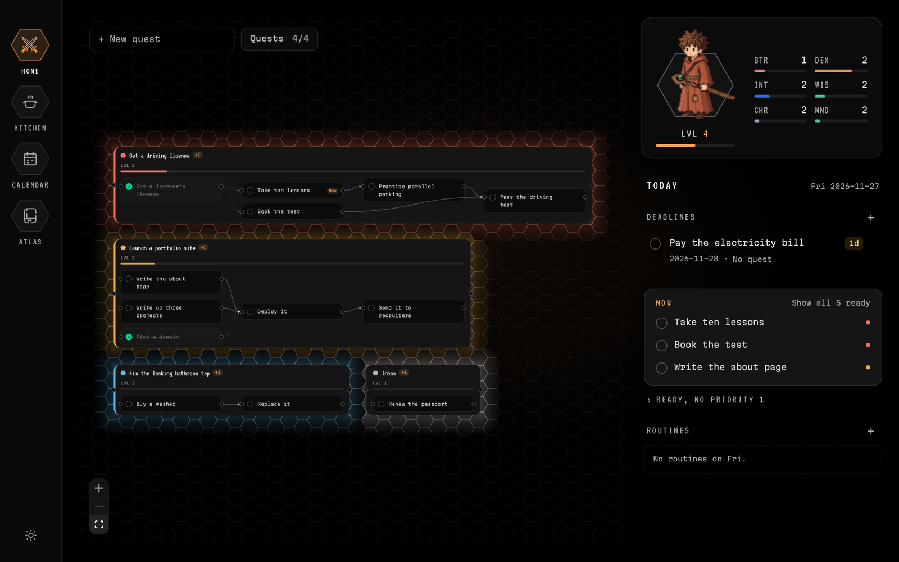
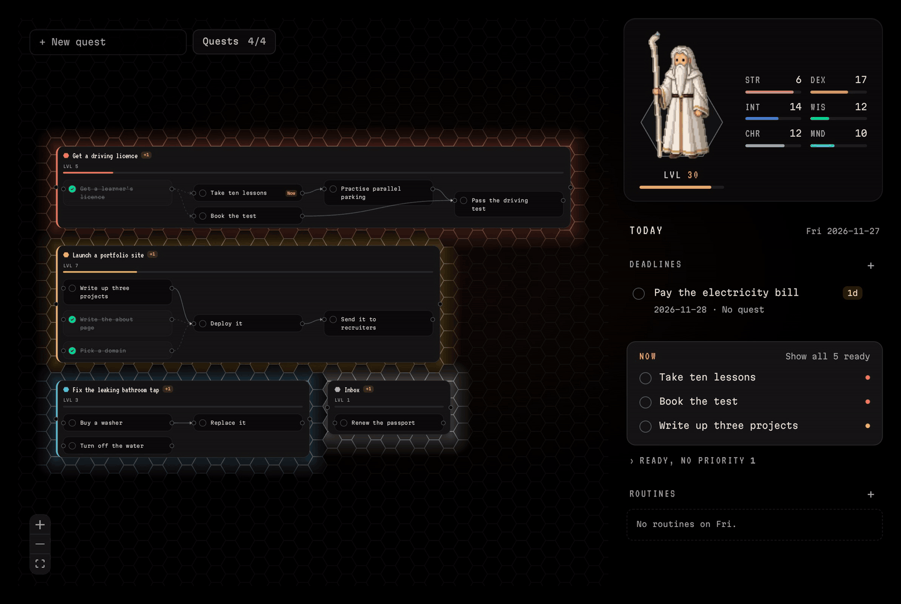
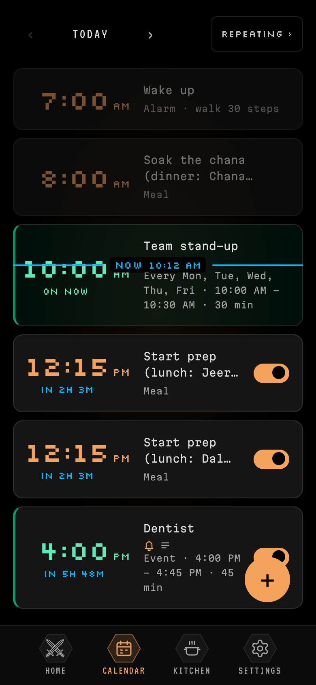
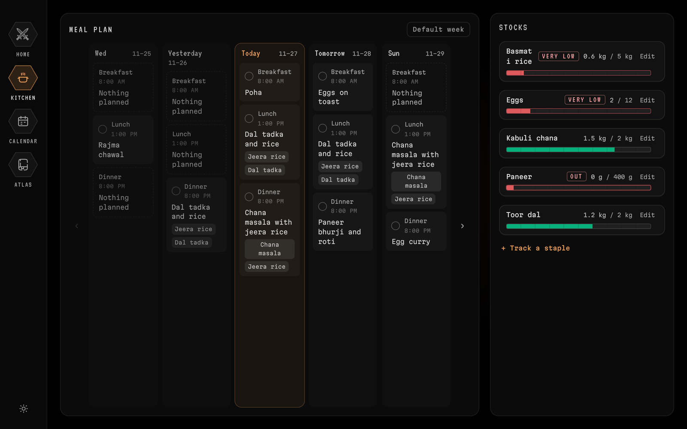

# Ashborn

**A place for an AI assistant to keep your day.**

## Why I built it

When I started living on my own, the things I had to stay on top of multiplied: meals and
groceries, chores, coursework, and then placements, with interviews and deadlines on top of it all.
Each lived somewhere different: alarms on my phone, events in a calendar, tasks in notes or in my
head. With no single source of truth, I often did not know what I had to do on a given day.

I wanted an AI assistant to manage all of it for me. What stopped me was not the assistant's
intelligence but its memory: an agent like Claude has no clean place to keep, read and update the
state of one's life (the schedule, the pending tasks, the alarms), so every conversation starts
from nothing.

## The problem it solves

Ashborn is that place. It is a database of tasks, events, alarms and meals, with a front end on the
desktop and on Android, and an [MCP](https://modelcontextprotocol.io) server through which an agent
reads and edits all of it, signed in as me. I plan with the agent in conversation and tell it to add
the steps we agree on; later I ask what to work on now, what is on tomorrow, or what to buy, and it
answers from the same state I see in the app.

Alongside the tasks, Ashborn keeps my calendar and alarms. Alarms ring natively on Android, even
when the app is closed, and a change made anywhere, by me or by an agent, reaches the phone within
seconds. So I can ask the agent to put an event on my calendar or set an alarm, and trust that it
will ring.

The kitchen keeps my recipes, a meal plan and stocks of staples. Each recipe carries its own
reminders: planning chana masala for dinner puts "Soak the chana" on that morning's alarms. Cooking
a meal deducts its ingredients, so the agent can tell me what to buy.

It runs on the desktop (Electron) and on Android, and every change shows up live on every device.



## Ask your agent

The agent reads and edits the same data as the app, through 48 tools, signed in as you.

**Planning.** Talk a goal through with your agent first, for as long as it takes. Once you have
agreed the steps, say "add those", and they go onto the to-do graph in one call, with their order
and nesting.

| You ask | It answers from |
|---|---|
| "What should I work on now?" | The ready steps in your to-do graph (every prerequisite done), ranked by the priorities you set. |
| "What's on tomorrow?" | Your events, your alarms and the meal plan's reminders for that day. |
| "Wake me at 6:30 tomorrow, and make the alarm stop only after sit-ups." | It adds the alarm; the phone rings until it has counted your sit-ups. |
| "What do I need to buy when I go out?" | The kitchen's staples below their target, and the open steps in your to-do graph that need something bought, such as "Buy a washer". |

## Tasks as a graph

A goal holds steps, steps hold steps, and links say "this before that". Looking at the graph shows
what is blocking what, and **Now** lists the few steps you can do next. Layout is automatic: you
never drag a card.

### Added by an agent over MCP



*One `add_plan` call to the MCP server adds the quest, its steps and their links. They appear in
the open app and are laid out on arrival.*

## Calendar and alarms



- **Events and alarms**, one-time or repeating, in a day view and a week or month calendar. The
  line marks the current time.
- **Alarms ring natively on Android**, over the lock screen, even with the app closed. A challenge
  alarm stops only once you have walked a number of steps or done your sit-ups.
- **The agent schedules for you.** "Book the dentist on Friday at four, and remind me at the
  start" becomes an event with a ring.
- **Changes reach the phone in seconds**, through push messages, whichever device or agent made
  them.

<br clear="right">

### Bonus: your agent can call you

An agent that needs you can ring your phone (the `call_user` tool). It rings like an incoming call,
with a short message saying what's needed, readable on the lock screen. If you miss it, you get a
"Missed call from Claude" notification with the message.

It's made for long agent runs. When Claude Code finishes, or gets stuck waiting for your input, it
calls you instead of sitting idle until you happen to check.

## Kitchen



- **Recipes carry their own reminders.** Plan chana masala for dinner, and "Soak the chana" and
  "Pressure-cook the chana" land on that day's alarms at the right times.
- **Stocks** of staples, with a target for each: cooking a meal deducts its ingredients, and what
  runs low is what the agent tells you to buy.
- **A meal plan** by day, with a default week for the days you don't plan.

The three parts meet in the calendar and the alarms, and the agent reaches all three.

## Install

Ashborn is self-hosted: you run it on your own free [Supabase](https://supabase.com) project, which
holds your data.

**You need** Node 22+, and, for the phone app, a JDK 21 and the Android SDK.

### 1. The backend

1. `npm install`
2. Create a Supabase project. Copy `.env.example` to `.env` and fill in the project URL and the
   publishable key (Project Settings → API keys).
3. Create the tables: `npx supabase login`, `npx supabase link --project-ref <your-ref>`,
   `npx supabase db push`.
4. Create your account: Authentication → Users → Add user, with "Auto Confirm User". The app has
   sign-in only, so accounts are made here.

### 2. The desktop app (Linux)

- `npm run electron:dev` runs it from the source.
- `npm run appimage` builds `release/Ashborn.AppImage`, and `scripts/install-appimage.sh` installs
  it and starts it at login, in the tray.

### 3. The Android app

The app is signed with your own key, and gets alarm changes and calls through Firebase Cloud
Messaging. Once:

1. Make the key: `keytool -genkeypair -keystore ~/.config/ashborn/release.keystore -alias ashborn
   -keyalg RSA -keysize 4096 -validity 10000`. Keep a copy: updates must be signed with it.
2. Add to `~/.gradle/gradle.properties`:
   ```
   ASHBORN_KEYSTORE=~/.config/ashborn/release.keystore
   ASHBORN_KEYSTORE_PASSWORD=...
   ASHBORN_KEY_ALIAS=ashborn
   ASHBORN_KEY_PASSWORD=...
   ```
3. Create a [Firebase](https://console.firebase.google.com) project and add an Android app with
   the package name `dev.ashborn.app`. Put its `google-services.json` in `android/app/`.
4. In Firebase, Project settings → Service accounts → Generate new private key. Then give the
   `push` function that key and a shared secret of your choosing, and deploy it:
   ```
   npx supabase secrets set FCM_SERVICE_ACCOUNT="$(cat service-account.json)" PUSH_SECRET=<secret>
   npx supabase functions deploy push --no-verify-jwt
   ```
5. Tell the database where the function is, in the Supabase SQL Editor:
   ```sql
   select vault.create_secret('https://<your-ref>.supabase.co/functions/v1/push', 'push_url');
   select vault.create_secret('<secret>', 'push_secret');
   ```

Then `npm run android:install` builds the app and installs it on a phone connected by USB (with USB
debugging on). On first start, allow notifications and alarms over the lock screen.

### 4. Your agent

- **Claude Code, on this computer:** `npm run agent:login` once, with your Ashborn email and
  password. In this folder Claude Code picks the server up from `.mcp.json`; to use it anywhere,
  `claude mcp add --scope user ashborn -- npm --prefix /path/to/Ashborn run -s agent`.
- **Claude on the web or the phone:** deploy the hosted connector (`npm run connector:deploy`),
  turn on Supabase's OAuth server (Authentication → OAuth Server), and point its authorization page
  at the consent page, built by `npm run connector:consent` and hosted on any static host. Then add
  `https://<your-ref>.supabase.co/functions/v1/mcp` as a custom connector in Claude.

## Licence

GPL-2.0-only, with an exception for the Android libraries the phone app links to (AndroidX, Apache
Cordova, Firebase Cloud Messaging): see [`LICENSE`](LICENSE) and [`NOTICE.md`](NOTICE.md).
Icons are from [Lucide](https://lucide.dev) (ISC).
